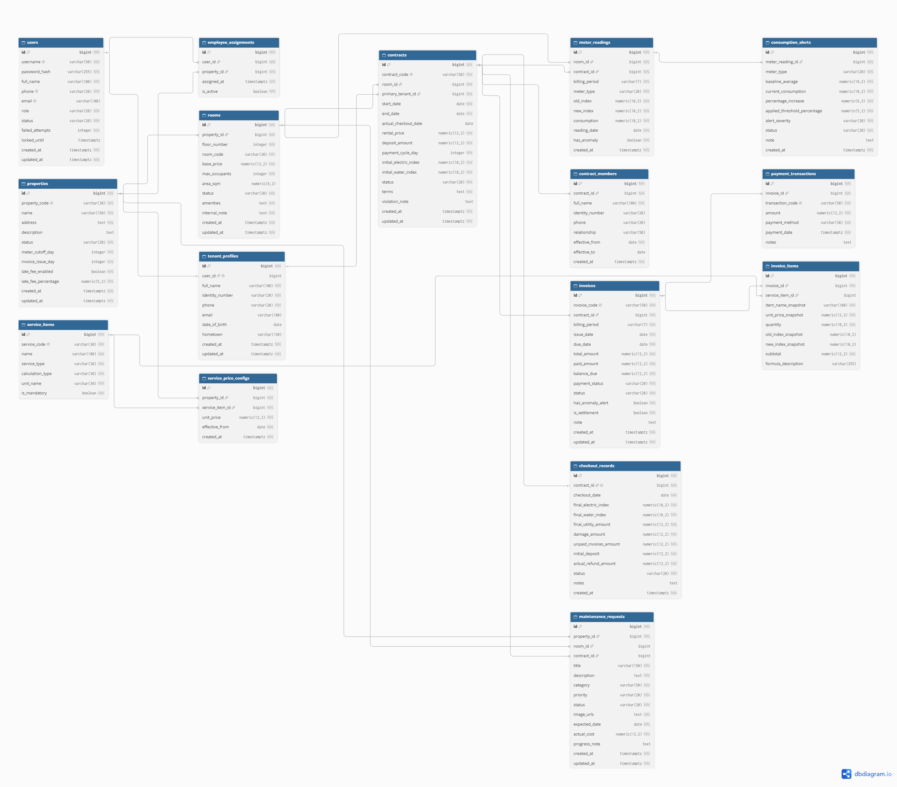

# Thiết kế cơ sở dữ liệu

Bản thiết kế do nhóm cung cấp từ dbdiagram.io gồm **16 bảng, 20 khóa ngoại và 5 chỉ mục UNIQUE ghép**.

- [DBML để mở và chỉnh sửa trên dbdiagram.io](quanlytro.dbml): chuyển từ bản SQL được cung cấp, giữ các cột, kiểu dữ liệu, giá trị mặc định, ghi chú và khóa.
- [SQL PostgreSQL gốc](quanlytro.sql): giữ nguyên nội dung file xuất từ dbdiagram.io.
- [Sơ đồ PDF](diagrams/quanlytro-dbdiagram.pdf): bản xuất gồm 2 trang.
- [Sơ đồ PNG đầy đủ](diagrams/quanlytro-dbdiagram.png): ảnh gốc 2905 × 2552 pixel.

## Phạm vi thiết kế và backend hiện tại

Đây là bản thiết kế rút gọn phục vụ trình bày bước 1–2. Backend hiện có schema 29 bảng theo Flyway V1–V9 trong `src/main/resources/db/migration`. Bản thiết kế gộp tầng vào `rooms.floor_number`; backend sử dụng bảng `floors` và `rooms.floor_id`. Một số bảng phụ trợ và trường phục vụ xác thực, phân công, lịch sử và vận hành cũng không có trong bản 16 bảng.

SQL này là tài liệu thiết kế, chưa phải migration thay thế schema đang chạy. Khi chạy ứng dụng, tiếp tục dùng các migration Flyway hiện có.

Các giá trị trạng thái liệt kê trong COMMENT/Note là mô tả nghiệp vụ; SQL gốc chưa tạo CHECK cho các tập giá trị này. Các tùy chọn `DEFERRABLE INITIALLY IMMEDIATE` của khóa ngoại được giữ trong SQL gốc; DBML chỉ thể hiện quan hệ và hành vi xóa.
