# Đối chiếu OpenKOS và việc cần làm tiếp

Ngày: **26/10/2026**. Tham chiếu [OpenKOS tại phiên bản aeb3544](https://github.com/senatroxx/OpenKos/tree/aeb354411dad78de3f13e7856d43c849c65b389e). Mục tiêu là dùng nghiệp vụ và test của dự án này để kiểm tra lại đồ án Java/PostgreSQL.

**Kết luận bước đầu:** giữ mô hình 49 bảng để kiểm chứng tiếp; chưa có căn cứ phải thiết kế lại DB chỉ vì OpenKOS tổ chức khác. Ưu tiên bổ sung ca kiểm thử ranh giới điện nước, tiếp nhận khách mới của nhân viên và biểu mẫu quyết toán có chi tiết.

Đợt này đọc mã, định nghĩa trạng thái, biểu mẫu và test OpenKOS rồi đối chiếu mã hiện tại. **Chưa dựng/chạy OpenKOS; chưa sửa DB, backend hay giao diện của đồ án trong bước đối chiếu này.** Kết quả 85 kiểm thử trong hồ sơ trước không được tính là bằng chứng các ca mới bên dưới đã đạt.

## 1. Đối chiếu theo nghiệp vụ

| Use Case hiện có | OpenKOS cho thấy điều gì | Tình trạng trong mã của nhóm | Việc tiếp theo |
| --- | --- | --- | --- |
| PA15/18 — Tiếp nhận khách, lập hợp đồng | Có luồng lập hợp đồng gắn người thuê/phòng | `Leases49.create` nhận được hồ sơ mới trong payload; form hợp đồng hiện chọn hồ sơ đã có, STAFF không được tạo hồ sơ qua CRUD chung | **P0:** hoàn thiện form khách mới ngay trong phòng được giao; test CCCD trùng ngoài phạm vi không lộ dữ liệu |
| PA18/19/24 — Ký, cư trú, nhận phòng | Trạng thái hợp đồng tập trung vào active/terminated/renewed | Nhóm có hợp đồng nháp, phiên bản đã ký, cư trú và lần nhận phòng riêng | Giữ cách tách hiện tại; không tự cộng người ký thành cư dân hoặc coi ký là đã giao chìa khóa |
| PA21 — Gia hạn | `RenewLease` kết thúc vai trò bản cũ bằng trạng thái renewed và tạo lease kế tiếp | Nhóm thêm `contract_terms` trong cùng hợp đồng | Giữ lịch sử phụ lục theo quyết định D09; test thời điểm đổi giá, không sao chép máy móc cách tạo lease mới |
| PA28/29 — Ghi/sửa chỉ số | Kiểm tra chuỗi chỉ số; có test số giảm, kỳ chồng và số đã có kỳ sau phụ thuộc | Có công tơ vật lý, điểm đo có phiên bản, khoảng tiêu thụ và chặn sửa nguồn đã tính tiền | **P0:** thêm test qua API/DB cho đầu kỳ đã sửa, khoảng đo chồng và chuỗi có kỳ sau |
| PA32/34 — Đưa điện nước vào hóa đơn | `UtilityBillingTest` có ca khoảng đo nằm ngoài/cắt qua ranh giới thuê và ca không tính hai lần | Đã thấy chọn đoạn theo hợp đồng, thời điểm chốt và nguồn chưa tính; đoạn code đã đọc chưa đủ chứng minh kiểm soát ranh giới nhận/trả phòng | **P0:** viết test trách nhiệm trước khi nhận phòng, sau khi trả và đoạn cắt qua hai khách |
| PA35/36 — Hóa đơn minh bạch | Có các dòng tiền điện nước gắn nguồn, giá snapshot và PDF | Đã có nguồn, công thức, kỳ dịch vụ, điều chỉnh và PDF | Rà một bộ số liệu mẫu; kiểm tra tổng dòng, điều chỉnh, phân bổ và nợ khớp nhau |
| PA37 — Sửa sai sau phát hành | Có test lập chênh lệch có dấu, liên kết dòng ban đầu | Có chứng từ điều chỉnh và bút toán giải phóng tiền đã phân bổ; test hiện có chủ yếu giảm khoản phải thu cố định | **P0:** bổ sung ví dụ sửa nhầm chỉ số điện đã thu tiền; không chỉ test khoản giảm giá chung |
| PA38/39 — Thu cọc, thanh toán | Tiền được xác nhận rồi phân bổ; test có trả một phần/đủ | Nhóm tách phiếu thu, quỹ và phân bổ; phần dư giữ trả trước | Giữ luồng hiện tại; không học quy tắc chặn ghi nhận toàn bộ khoản chuyển dư của OpenKOS |
| PA41/42/43/44 — Quyết toán, bồi thường, hoàn | Biểu mẫu có từng khấu trừ, số hoàn, ngày, tham chiếu; bản chốt bị khóa | Có API chứng từ bồi thường/điều chỉnh, quỹ, tạm giữ và hoàn; UI hiện có nút duyệt/hoàn nhưng chưa gom hạng mục thiệt hại thành một luồng rõ | **P1:** làm màn hình quyết toán có chi tiết, căn cứ và số dư; tách “cần hoàn” với “đã chi” |
| PA45/46 — Sự cố | Có kiểm tra quyền theo cơ sở và các trạng thái xử lý | Nhóm hỗ trợ phòng/khu chung/tài sản; có tiếp nhận, đang sửa, hoàn thành và mở lại | **P1:** test người ngoài phạm vi, mở lại lỗi tái phát và chi phí không tự trở thành nợ người thuê |
| PA30/31 — Cảnh báo bất thường | Trong phần đã khảo sát chưa xác minh được bộ cảnh báo tương đương yêu cầu của nhóm | Có so mức dùng/ngày, nguồn baseline, thiếu lịch sử và khác nhóm thuê | Giữ đây là nghiệp vụ riêng; tiếp tục kiểm thử, không thay bằng nhắc nợ/nhắc kỳ thu tiền |

P0: ưu tiên kiểm chứng tính đúng hoặc khả năng dùng luồng chính. P1: hoàn thiện cách thao tác và tra soát sau khi các quy tắc đã được kiểm chứng.

Nguồn OpenKOS cho bảng: [gia hạn](https://github.com/senatroxx/OpenKos/blob/aeb354411dad78de3f13e7856d43c849c65b389e/app/Actions/Leases/RenewLease.php), [test điện nước vào hóa đơn](https://github.com/senatroxx/OpenKos/blob/aeb354411dad78de3f13e7856d43c849c65b389e/tests/Feature/UtilityBillingTest.php), [test chuỗi số đo](https://github.com/senatroxx/OpenKos/blob/aeb354411dad78de3f13e7856d43c849c65b389e/tests/Feature/UtilityReadingTest.php), [xác nhận tiền](https://github.com/senatroxx/OpenKos/blob/aeb354411dad78de3f13e7856d43c849c65b389e/app/Actions/Payments/VerifyPayment.php), [biểu mẫu quyết toán](https://github.com/senatroxx/OpenKos/blob/aeb354411dad78de3f13e7856d43c849c65b389e/resources/js/components/features/leases/deposit-settlement-fields.tsx), [test quyền sự cố](https://github.com/senatroxx/OpenKos/blob/aeb354411dad78de3f13e7856d43c849c65b389e/tests/Feature/MaintenanceTicketTest.php).

Mã nhóm đã đối chiếu: [Leases49](../src/main/java/com/hostel/model49/Leases49.java), [Billing49](../src/main/java/com/hostel/model49/Billing49.java), [Meters49](../src/main/java/com/hostel/model49/Meters49.java), [Finance49](../src/main/java/com/hostel/model49/Finance49.java), [Settlements49](../src/main/java/com/hostel/model49/Settlements49.java), [Operations49](../src/main/java/com/hostel/model49/Operations49.java), [biểu mẫu](../frontend/src/Model49Panels.jsx), [test hiện có](../src/test/java/com/hostel/Model49Tests.java).

## 2. Chốt ý nghĩa trạng thái trước khi sửa giao diện

Không ánh xạ chỉ vì hai hệ thống dùng cùng tên “pending”. Trong OpenKOS, enum hóa đơn chứa cả pending/partial/paid; bài của nhóm tách việc phát hành với tình trạng trả tiền. [Enum hóa đơn OpenKOS](https://github.com/senatroxx/OpenKos/blob/aeb354411dad78de3f13e7856d43c849c65b389e/app/Enums/InvoiceStatus.php).

| Đối tượng | Ý nghĩa cần giữ trong bài |
| --- | --- |
| Hợp đồng | DRAFT là đang soạn; ACTIVE là hợp đồng đã được ghi nhận ký. Ký không chứng minh đã nhận phòng hoặc đã nộp cọc |
| Nhận/trả phòng | `room_possessions` là thời điểm giao/nhận thực tế. Hết hạn giấy chưa giao trả vẫn chưa được coi là phòng trống |
| Hóa đơn | DRAFT/ISSUED nói về phát hành; UNPAID/PARTIALLY_PAID/PAID là kết quả từ phân bổ tiền và điều chỉnh |
| Phiếu thu | PENDING chưa tăng số dư; CONFIRMED mới là khoản tiền đã được kiểm tra |
| Quyết toán | DRAFT/APPROVED là duyệt quyết toán; APPROVED chưa có nghĩa tiền hoàn đã ra khỏi quỹ |
| Bảo trì | NEW → ACCEPTED → IN_PROGRESS → COMPLETED; có thể hủy hoặc mở lại theo căn cứ, giữ lịch sử |

Luồng thao tác mục tiêu để kiểm thử:

```mermaid
flowchart LR
    A[Tiếp nhận khách] --> B[Hợp đồng nháp]
    B --> C[Ghi nhận đã ký]
    C --> D[Kiểm tra cọc và quyền giao phòng]
    D --> E[Giao phòng và ghi người thực ở]
    E --> F[Ghi số - kiểm tra - phát hành hóa đơn]
    F --> G[Thu tiền và phân bổ]
    G --> H[Báo trả - bàn giao thực tế]
    H --> I[Duyệt các khoản quyết toán]
    I --> J[Cấn nợ và ghi hoàn thực tế]
```

Phiếu thu có thể được ghi ở nhiều thời điểm theo giao dịch thực; sơ đồ không buộc người thuê chỉ được nộp tiền sau khi ký. Các sự kiện tương ứng vẫn phải có căn cứ và trạng thái riêng.

## 3. Bộ ca bổ sung cần làm trước

Đây là **ca đề xuất, chưa được chạy trong bước đối chiếu**. Nếu trùng test hiện có thì mở rộng test đó, không tạo test chỉ đổi tên.

| Mã | Tình huống | Kết quả cần chứng minh |
| --- | --- | --- |
| OK01 | STAFF tiếp nhận khách chưa có hồ sơ ở phòng được giao, qua giao diện | Tạo hồ sơ + nháp trong cùng quy trình; không phải nhờ ADMIN cho mọi khách mới |
| OK02 | Khách có CCCD thuộc hồ sơ ở khu ngoài phạm vi của STAFF | Không tạo trùng và không trả thông tin riêng của hồ sơ đó; chuyển ADMIN xác minh |
| OK03 | Gán cho hợp đồng một khoảng điện bắt đầu trước khi người thuê nhận phòng | Không tự thu toàn bộ khoảng; phải có điểm tách hoặc căn cứ trách nhiệm rõ |
| OK04 | Khoảng đo cắt qua thời điểm người cũ trả và người mới nhận | Không tính trùng cho hai khách; phần trống thuộc trách nhiệm đã xác định |
| OK05 | Ghi hai khoảng công tơ chồng nhau; hoặc đầu kỳ không khớp điểm đang có | Từ chối hoặc yêu cầu quy trình sửa có lịch sử; không âm thầm tạo điểm khác |
| OK06 | Gửi hai yêu cầu lập hóa đơn cùng lúc cho cùng nguồn đo | Một khoản tiêu thụ chỉ có một dòng thu gốc; không sinh hóa đơn tháng trùng |
| OK07 | Chỉ số đã dùng phát hành, phát hiện nhập thừa 10 kWh | Giữ bản gốc, lập chênh lệch giảm 35.000 nếu đơn giá nguồn là 3.500; không dùng giá hiện tại khác giá gốc |
| OK08 | Hóa đơn đã trả đủ rồi mới điều chỉnh giảm | Nợ không âm; phần phân bổ thừa về đúng quỹ nguồn; chưa tự ghi đã hoàn tiền |
| OK09 | Khách chuyển 4.000.000 cho hóa đơn 3.620.000, sau đó gửi lại cùng mã phiếu | Tiền thật chỉ ghi một lần; nợ hết; trả trước còn 380.000 |
| OK10 | Cọc cam kết 2.000.000, thực nhận 1.500.000 | Chỉ 1.500.000 là tiền giữ; giao phòng thiếu cọc cần quyền và căn cứ |
| OK11 | Quyết toán có hai thiệt hại, một khoản còn tranh chấp | Mỗi khoản có căn cứ và trạng thái; khoản tranh chấp không tự bị cấn cọc |
| OK12 | Thiệt hại được duyệt 2.000.000, cọc khả dụng chỉ 1.500.000 | Cấn tối đa 1.500.000; còn nợ 500.000, không làm biến mất phần vượt cọc |
| OK13 | Duyệt số phải hoàn rồi chuyển khoản chưa thành công; bấm lại | Chưa có chi thực tế thì số dư chưa giảm; cùng phiếu không được hoàn hai lần |
| OK14 | Hợp đồng hết ngày giấy nhưng người thuê chưa giao trả | Phòng vẫn có người chiếm hữu; không giao tiếp cho người mới chỉ vì ngày giấy đã hết |
| OK15 | Báo sửa ở phòng trống/khu chung, người ngoài phạm vi xem hoặc sửa yêu cầu | Không cần hợp đồng giả; người ngoài phạm vi bị chặn ở API |

Các ca đã có nền kiểm thử: tiền dư, cọc thực nhận, hoàn gửi lại, bất biến chứng từ và cạnh tranh phân bổ. Chưa suy từ đó rằng toàn bộ OK01–OK15 đã đạt; phải gắn từng ca với test và kết quả cụ thể.

## 4. Những biểu mẫu nên hoàn thiện sau khi kiểm tra P0

| Biểu mẫu | Thông tin người vận hành cần nhìn thấy |
| --- | --- |
| Tiếp nhận khách | Phòng đang tiếp nhận; hồ sơ có sẵn hoặc khách mới; kết quả xác minh trùng; người ký khác với danh sách thực ở |
| Giao phòng | Ngày đã ký; cọc cam kết/thực giữ/còn thiếu; quyền cho thiếu cọc; thời điểm giao và biên bản |
| Nhập điện nước | Mã công tơ; điểm đầu đã có; khoảng đo; người chịu trách nhiệm; ảnh; lượng dùng và lỗi cần xử lý |
| Xác minh tiền vào | Số thực vào; ngày thực nhận; quỹ/tài khoản; tham chiếu; mục đích giữ; phần phân bổ và phần dư |
| Quyết toán trả phòng | Ngày trả thực tế và ngày hết tính tiền; từng khoản nợ/khấu trừ; căn cứ; tranh chấp; số tạm giữ và ngày rà lại; số có thể hoàn |
| Ghi chi hoàn | Quỹ nguồn; người nhận; phương thức; số tiền; thời điểm chi; mã chống trùng; bằng chứng tiền đã ra |

Đây là yêu cầu thông tin, chưa phải thiết kế giao diện đã duyệt. Không mặc định điền toàn bộ cọc cam kết thành số tiền đã nhận hoặc số đã hoàn chỉ để tiện thao tác.

## 5. Thứ tự thực hiện tiếp

1. **Kiểm chứng P0 trên Java/PostgreSQL hiện tại:** chuyển các ca ranh giới điện nước, nguồn tính trùng và điều chỉnh sau thu thành test; chạy trên database thử riêng. Ca chưa đạt mới thành lỗi cần sửa, kèm nguyên nhân ở service/SQL.
2. **Hoàn thiện luồng người dùng:** tiếp nhận khách mới trong phòng được giao và quyết toán theo hạng mục. Dùng cấu trúc dữ liệu hiện có trước; chỉ đề nghị migration mới khi chứng minh thiếu dữ kiện/ràng buộc.
3. **Chạy một kịch bản đầy đủ trên giao diện:** tiếp nhận → ký → thu cọc → giao phòng → hóa đơn → thu dư → điều chỉnh → trả phòng → cấn/hoàn. Lưu số liệu, PDF và ảnh minh chứng, rồi cập nhật Use Case/ERD/slide theo thay đổi thực tế.

Đầu ra của bước 1 phải là bảng **ca nào đạt, ca nào chưa đạt, sửa ở đâu**. Đầu ra của bước 2 phải có luồng dùng được bằng giao diện. Mô hình 49 bảng hiện tại là cơ sở kiểm tra, không được coi là đã đúng toàn bộ chỉ vì migration và các test trước đã qua.
