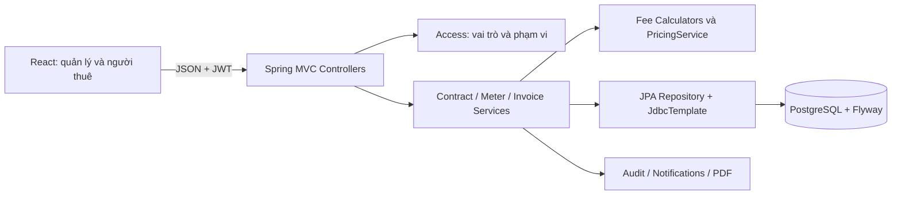
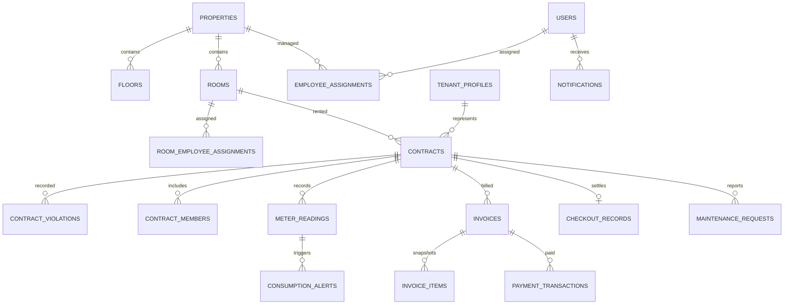

# Báo cáo đồ án Java/Web

> Báo cáo lịch sử của prototype trước Flyway V10. Hồ sơ báo cáo bước 1–2 hiện hành nằm trong [DATABASE.md](DATABASE.md); backend/API hiện hành xem [BACKEND-17-TABLES.md](BACKEND-17-TABLES.md).

**Đề tài:** Hệ thống quản lý nhà trọ với hóa đơn minh bạch và cảnh báo tiêu thụ điện nước bất thường.

**Thông tin cần điền trước khi nộp:** họ tên/MSSV, lớp, giảng viên hướng dẫn, tên trường. Chưa có thông tin nhóm trong yêu cầu nên không gán tên tác giả.

## 1. Bài toán và phạm vi

Một chủ nhà quản lý 1–3 khu, mỗi khu có tầng, phòng và nhân viên phụ trách. Ghi chép thủ công khiến việc tra cứu người thuê, đơn giá, công nợ và số điện nước khó kiểm chứng. Hệ thống đưa các nghiệp vụ vào cùng một database, giữ lịch sử và phân quyền tại backend.

V1 là web React và REST API Java. Luồng chính: phòng trống → hồ sơ người thuê → hợp đồng/cọc → chỉ số → kiểm tra cảnh báo → hóa đơn → thanh toán → trả phòng/cấn trừ cọc. Mobile, thanh toán ngân hàng thật, AI và IoT là hướng mở rộng.

## 2. Vai trò và use case

| Vai trò | Use case |
|---|---|
| Chủ nhà | tài khoản/phân công, khu/tầng/phòng, người thuê/hợp đồng, điện nước/đơn giá, hóa đơn/thanh toán, sự cố/bảo trì, thông báo, báo cáo, audit |
| Nhân viên | nghiệp vụ tại khu hoặc phòng cụ thể được giao; không truy cập ngoài phạm vi |
| Người thuê | phòng/hợp đồng/hóa đơn của mình, công thức và giao dịch, báo sự cố, theo dõi thông báo |

Chủ nhà có quyền toàn hệ thống. Nhân viên được kiểm tra employee_assignments (toàn khu) và room_employee_assignments (phòng riêng) ở từng tài nguyên, báo cáo và tệp ảnh. Người thuê được kiểm tra tenant_profiles.user_id → contracts.primary_tenant_id. Ẩn nút trên web chỉ hỗ trợ trải nghiệm; quyền thực tế được xác nhận ở API.

## 3. Kiến trúc và tổ chức mã nguồn

Controllers tiếp nhận DTO được Bean Validation kiểm tra. Services giữ quy tắc và transaction. JPA ánh xạ quan hệ cốt lõi, đọc snapshot chi tiết hóa đơn qua InvoiceItemRepository. JdbcTemplate thực hiện các truy vấn nghiệp vụ cần khóa hàng, upsert và cấu trúc PostgreSQL. Hai cơ chế dùng cùng datasource và JpaTransactionManager, được kiểm tra trong bộ workflow.

OOP thể hiện qua FeeCalculator và các bộ tính phòng/điện/nước/dịch vụ. IoC inject services và calculators. Spring MVC xử lý REST; Spring Security xử lý JWT; AOP ApiTimingAspect đo thời gian controller và không ghi request/password. Audit ghi thay đổi nghiệp vụ trong cùng transaction để tránh log thành công khi dữ liệu rollback.

Frontend được build bằng Vite rồi nhúng vào JAR, cùng origin với API. Các component form/table/detail dùng chung token CSS và Inter được self-host. UI tiếng Việt, nền sáng, không bật dark mode. Các số trên UI đến từ API; dữ liệu mẫu chỉ được tạo bằng script demo.

## 4. Thiết kế dữ liệu

Các nhóm bảng: users/auth_sessions/password_reset_codes; properties/floors/rooms/employee_assignments/room_employee_assignments; tenant_profiles/contracts/contract_members/contract_violations; service_items/service_price_configs/alert_thresholds; meter_readings/consumption_alerts; invoices/invoice_items/payment_transactions/checkout_records; maintenance_requests/maintenance_schedules; notifications/audit_logs/meter_reading_history/room_images/room_price_history/uploaded_images. Tổng cộng 29 bảng nghiệp vụ sau 9 migration.

Database có unique hóa đơn/hợp đồng/kỳ, unique chỉ số/hợp đồng/kỳ/loại để hỗ trợ đổi người thuê giữa tháng, check chỉ số tăng và consumption=new-old, check tiền thanh toán/balance, khóa ngoại phòng–tầng–khu. Exclusion constraint GiST loại bỏ hợp đồng ACTIVE chồng thời gian. Flyway áp dụng migration tuần tự, không tạo bảng bằng Hibernate; ddl-auto=validate kiểm tra mapping.

## 5. Hóa đơn minh bạch

Mỗi invoice_item lưu tên khoản thu, đơn giá, lượng dùng, chỉ số cũ/mới, thành tiền và mô tả công thức. Tiền điện/nước = (mới − cũ) × đơn giá. Ví dụ nước 128−120=8, giá 20.000, thành tiền 160.000.

Tiền phòng và dịch vụ cố định = đơn giá × số ngày ở / số ngày tháng. Dịch vụ đầu người dùng tổng ngày-người; thành viên chuyển vào/rời phòng có mốc thời gian riêng. Ngày kết thúc/trả phòng không được tính vào thời gian ở. Tiền dùng BigDecimal, làm tròn HALF_UP ở thành tiền, không dùng double.

Tạo hóa đơn là một transaction: bất kỳ thiếu giá bắt buộc hay thiếu chỉ số đều rollback cả hóa đơn và dòng. Một kỳ chỉ có một hóa đơn. Nháp có thể xóa và tính lại; sau phát hành không được sửa dữ liệu tính tiền. Đơn giá áp dụng tại đầu tháng, giá tương lai không thay snapshot cũ.

## 6. Cảnh báo tiêu thụ

Baseline = trung bình consumption các kỳ trước trong cửa sổ cấu hình (1–12 tháng). Phần trăm tăng = (hiện tại − baseline) / baseline × 100. Cấu hình theo phòng ưu tiên hơn cấu hình khu, mặc định 50%/3 tháng. Khi không có lịch sử hoặc baseline=0, không kết luận theo phần trăm.

Ví dụ 8, 9, 10 m³ → baseline 9; kỳ mới 27 → tăng 200%, vượt 50%. Quản lý xem và sửa chỉ số nếu nhập nhầm, hoặc xác nhận nếu số đúng. Cảnh báo PENDING chặn phát hành. Sửa chỉ số lưu giá trị trước/sau, người sửa, thời gian và lý do; chỉ sửa kỳ cuối chưa có hóa đơn.

## 7. Thanh toán và quyết toán

Một hóa đơn có nhiều giao dịch. paid_amount bằng tổng số được ghi nhận, balance_due=total_amount−paid_amount, trạng thái UNPAID/PARTIALLY_PAID/PAID. Ghi nhận thủ công, không xác minh ngân hàng thật. Invoice được khóa FOR UPDATE trước khi thu, ngăn hai thao tác cùng đọc công nợ cũ.

Trả phòng chốt chỉ số cuối và tiền kỳ cuối. Chỉ hoàn tất khi mọi tháng đã ở có hóa đơn và cảnh báo đã được kiểm tra. Tiền cọc trừ thiệt hại, rồi cấn hóa đơn theo kỳ; có giao dịch DEPOSIT_OFFSET để tra soát. Số hoàn âm biểu thị số còn phải trả. Hợp đồng kết thúc và phòng về AVAILABLE trong cùng transaction.

## 8. Bảo mật

PasswordEncoder BCrypt, JWT ký HMAC, không lưu mật khẩu rõ. Access token 30 phút; refresh token ngẫu nhiên lưu SHA-256, dùng 7 ngày và xoay khi cấp lại. token_version vô hiệu hóa token cũ khi đăng xuất/đổi mật khẩu/khóa tài khoản. Năm lần sai khóa tạm 15 phút; chủ nhà có thể mở khóa.

Reset code được cấp sau khi chủ nhà xác minh người dùng, lưu hash, hết hạn 15 phút, dùng một lần. Bản triển khai prod bắt buộc cung cấp JWT_SECRET và thông tin DB. SQL dùng bind parameter; các đoạn SQL phạm vi được tạo từ vai trò đã xác thực và userId kiểu số. Dữ liệu nhạy cảm không được ghi trong AOP timing.

## 9. Sự cố, thông báo và báo cáo

Sự cố chuyển NEW → ACCEPTED → IN_PROGRESS → COMPLETED, có ưu tiên, hạn dự kiến, người xử lý đúng khu/phòng được giao, chi phí thực tế và ảnh JPEG/PNG tải từ máy hoặc URL. Ảnh có giới hạn 6 MB, 12 ảnh/tài nguyên; kiểm tra bộ giải mã ảnh, độ phân giải và quyền đọc. Docker dùng volume ảnh độc lập. Lịch bảo trì ghi chu kỳ ngày và dịch ngày kế tiếp khi đánh dấu hoàn tất.

Thông báo riêng có thời gian và trạng thái đã đọc; hỗ trợ hóa đơn phát hành, quá hạn, hợp đồng sắp hết hạn, cảnh báo điện nước, sự cố và thông báo chung. Reminder chạy mỗi giờ, khóa reference_key tránh tạo trùng.

Dashboard và báo cáo tách tiền đã lập hóa đơn theo kỳ, tiền thực tế nhận theo tháng của payment_date (Asia/Ho_Chi_Minh), tiền đã bù vào hóa đơn và số còn nợ. DEPOSIT_OFFSET là cấn cọc nội bộ, không cộng vào tiền thu mới. Báo cáo có kỳ tháng/quý, công nợ chi tiết, lấp đầy hiện tại/lịch sử cuối tháng và chi phí sự cố. PDF nhúng Noto Sans có tiếng Việt; CSV có BOM UTF-8 và tránh công thức khi mở bảng tính.

## 10. Kiểm thử và kết quả

JUnit/SpringBootTest kiểm tra trên PostgreSQL thật. Các test bao gồm công thức, chia theo ngày/người, cảnh báo và chặn phát hành, hóa đơn trùng, snapshot, sửa chỉ số, phân quyền STAFF/TENANT, thu vượt nợ, trả phòng và cấn cọc. HTTP tests kiểm tra filter JWT, refresh dùng một lần, logout, đổi mật khẩu và khóa đăng nhập. PDF test đọc lại văn bản tiếng Việt từ file xuất.

Kết quả và ảnh trình duyệt được ghi trong VALIDATION.md sau lần build cuối. Kịch bản DEMO.md dùng dữ liệu thống nhất với các quy tắc trên. Dockerfile/Compose đã chạy kiểm chứng qua Docker Engine trong Ubuntu/WSL, dùng cổng/database/volume riêng, không đụng database demo trên Windows. Kết quả chi tiết trong VALIDATION.md.

## 11. Giới hạn và phát triển tiếp

Có kho upload ảnh với quyền truy cập. Khôi phục mật khẩu qua mã một lần, không có SMTP. Ngày chốt/phát hành được áp dụng thống nhất ở API; lập/phát hành vẫn cần quản lý chủ động thao tác để kiểm tra chỉ số. Vi phạm có trạng thái và nhật ký xử lý. Phí chậm thu ở kỳ kế tiếp, chưa có phiếu điều chỉnh/hoàn tiền cho hóa đơn đã phát hành. Danh sách chưa phân trang ở server; phù hợp quy mô nhỏ của đề tài, cần bổ sung khi tăng dữ liệu. Phân công hỗ trợ toàn khu và từng phòng độc lập. Bảng kê CSV và PDF đã có, chưa có định dạng XLSX riêng.

Mobile sẽ dùng lại REST API, các quy tắc backend và PostgreSQL. Mở rộng tiếp: email, phân trang, phiếu điều chỉnh, snapshot số phòng lịch sử khi thay cơ cấu khu, tăng kiểm thử đồng thời và triển khai HTTPS.
